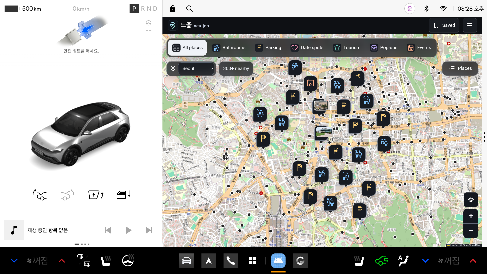
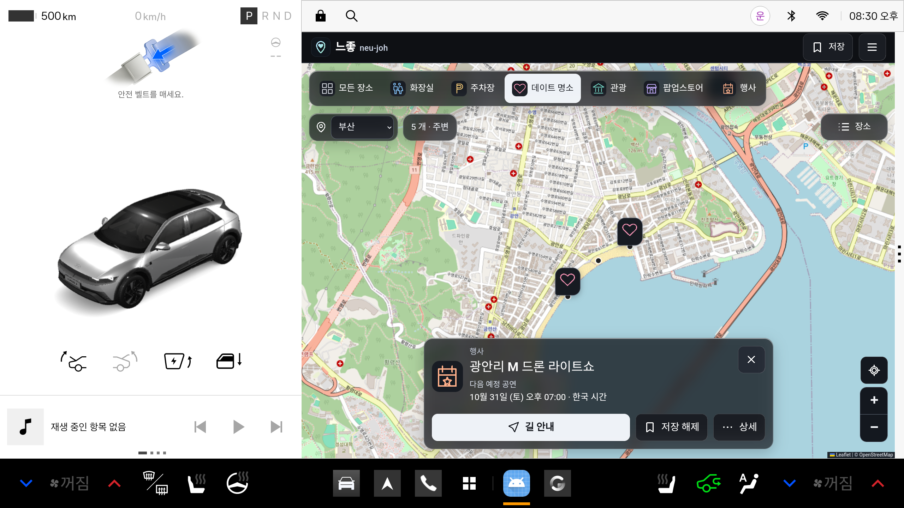

# 느좋 NeuJoh (Feels Good)

An in-car places app for Pleos Connect and Android Automotive that finds public toilets, parking, good-vibe spots, tourist sights, pop-up stores and cultural events across South Korea.

느좋은 플레오스 커넥트(Pleos Connect)와 안드로이드 오토모티브용 차량 앱입니다. 전국 공중화장실, 주차장, 데이트 명소, 관광지, 팝업스토어, 행사를 지도에서 찾고 바로 길안내를 시작하세요.

[](../../releases/latest)   

[Download the APK](../../releases/latest) · Korean, English and Japanese · Works offline



## Why NeuJoh

느좋 is Korean slang for "feels good". The app puts the places worth stopping for on the car's centre display and hands them to your navigation app with one tap. The full release covers 104,704 sourced places, including 11,318 public toilets and 50,077 parking places.

## Features

- Map of Korea with category filters for toilets, parking, vibes, tourism, pop-ups and events
- Search for any city or area in Korean, English or Japanese
- One-tap navigation through Pleos navigation, Naver Map, Kakao Map or Google Maps
- Saved places and private notes that never leave the device
- Driving awareness that rests the controls once the car leaves Park and follows the brake, turn signals, hazards, reverse and doors with soft light cues
- Next show times for recurring events such as the Banpo Rainbow Fountain and the Gwangalli drone show
- Import your own places from a public JSON feed
- Offline place data with no account and no tracking by default



## Install

Download `neu-joh-<version>.apk` from [Releases](../../releases/latest) and install it on a Pleos Connect car, the Pleos Connect emulator or an Android 10+ phone.

```
adb install -r neu-joh-<version>.apk
```

## Build from source

This repository ships a small sample of real places around Seoul City Hall so the app builds and its tests run. The APK on the Releases page carries the full nationwide data.

You need Node.js 20+, pnpm, JDK 17 and the Android SDK. Install the Pleos Connect system image from the Android SDK Manager to run the car emulator.

```
pnpm install
pnpm bootstrap      # checks tools and writes local.properties
pnpm test           # web and Android unit tests
pnpm build          # web UI and debug APK
pnpm ui             # web UI in the browser
pnpm car            # emulator, web UI and a car control page
pnpm device         # install on a USB phone
```

`pnpm car` opens a control page with gear, pedals, turn signals and doors. The web UI and the app on the emulator react to it, so you can try the driving cues without a car. Add `--web` for the browser only or `--automotive` for an Android Automotive 15 emulator.

## Tech stack

Kotlin with the Pleos Vehicle SDK and NaviHelper on Android. Vue 3, TypeScript, Tailwind CSS and Leaflet for the interface. Vite for the web build and Gradle for Android.

## Privacy

Saved places, notes and edits stay on the device. The app has no account, token or secret. Analytics stay off unless a build is set up with a PostHog project, and names, coordinates, addresses, notes and search text are never sent.

## Data and licences

Places come from OpenStreetMap, Seoul and national public data, Korea Tourism Organization, Wikipedia and official event pages. Every record links to its source. Parking shows capacity, not live free spaces. The app never invents reviews or ratings.

- OpenStreetMap data © OpenStreetMap contributors, ODbL 1.0
- Seoul and national public data under Korea Open Government License Type 1
- Photos from Wikimedia Commons under CC BY-SA, credited on each place
